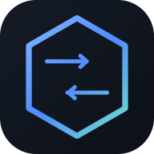
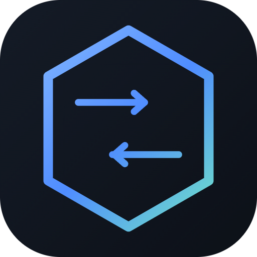

# SixDrop

> 六位取件码 · 浏览器直连 · 文件不经过服务器

一个跑在 Cloudflare Workers 上的浏览器点对点传文件站：

**线上地址：<https://sixdrop.dev>**

- 打开页面 → 选文件（可多选）→ 得到一个 6 位取件码
- 对方输入取件码 → 确认后双方浏览器 **WebRTC DataChannel 直连**对传
- 多文件时接收端选一个文件夹，全部自动存进去
- **不想传文件也可以只发一段文字**：首页切到「发送文本」标签，连上就能互发消息
- **一个房间从头用到尾**：码只发一次，文件面板和文本面板随时切；传完一批还能在同一个房间再发一批
- 文件字节不经过 Cloudflare，服务器只负责交换 SDP 和候选
- 不配置 TURN：打不通就明确告诉你「换网络 / 重试」，不会偷偷把文件传上云

信令层在免费额度内（Workers Free + Durable Objects Free），成本为 0。

域名：**`sixdrop.dev`**（已注册并绑定）。`.com` 已被他人持有，`.app` 同价首年但续费更贵，没买。

## 目录
```
src/worker.js      Worker 入口：/api/room 建房、/ws 升级、其余交给静态资源
src/room.js        Durable Object：一个房间一个实例，只转发信令
public/index.html  单页界面
public/app.js      WebRTC、分块发送、背压、落盘、失败态
public/style.css
test/              纯 Node 跑的单元测试（不需要 wrangler 账号）
wrangler.jsonc
```

## 部署

需要 Node 18+ 和一个 Cloudflare 账号（免费版即可，不用绑卡）。

```bash
npm install
npx wrangler login
npm run deploy
```

第一次部署会创建 Durable Object 命名空间。部署完成后访问：

```
https://sixdrop.<你的子域>.workers.dev
```

本地调试有两个选择：

```bash
npm run dev        # wrangler dev，最接近线上，需要先 npm install
npm run dev:local  # 零依赖垫片，用 Node 直接跑真实的 worker/room 代码
```

`dev:local` 走 `tools/dev-server.mjs`：它把 `Response`、`WebSocketPair`、Durable Object 的 `ctx` 用 Node 模拟出来，业务代码一份不改。适合没装 wrangler 时快速验证，**不要用来上线**。

> WebRTC 需要安全上下文，`localhost` / `127.0.0.1` 和 `https://` 都可以；用局域网 IP 直接访问 `http://192.168.x.x` 时浏览器会禁用 DataChannel。

## 绑定 sixdrop.dev

1. Cloudflare 控制台 → **Add a site** → 输入 `sixdrop.dev`，选 Free 计划
2. 按提示去注册商后台，把 NS 改成 Cloudflare 给的那两个
3. 等 zone 变成 **Active**（通常几分钟到几小时）
4. 解开 `wrangler.jsonc` 末尾 `routes` 那一行的注释，再 `npm run deploy`

`custom_domain: true` 会自动创建 DNS 记录并签发证书，不用手动加 CNAME。`workers.dev` 的子域会同时保留，两个地址都能访问。

## 为什么没有 TURN

Cloudflare Workers 没有 UDP 入站，没法自建 TURN；官方 Realtime TURN 是 $0.05/GB。这个项目默认**不中继**：

- 直连成功：速度只受双方上行限制，服务器零带宽成本
- 直连失败（对称 NAT、公司/校园网、部分 4G/5G）：给失败页 + 诊断信息，并提供「重新尝试」
- 默认情况下，失败时文件不会上传到任何地方

## 中转兜底（R2）

打洞失败时可以临时切到「经 R2 中转」：发送方直传对象存储，收件人拿预签名链接下载，24 小时后自动删除。

**这是可选的**。没配置 R2 凭据时，`/api/relay/status` 返回 `enabled: false`，失败页不会出现「改用中转」按钮。

### 配额与限制（R2 官方）

| 项目 | 限制 |
| --- | --- |
| 单次 PUT | 5 GiB |
| 分片上传 | 4.995 TiB，最多 10,000 片 |
| 走 Worker 代理上传 | 100 MB（免费套餐请求体上限）→ 所以必须直连 S3 端点 |
| 预签名链接有效期 | 24 小时（aws4fetch 默认） |

≤5 GiB 走单次 PUT；超过则自动切 multipart（每片 ≤5 GiB，按 10,000 片反推大小）。

### 传输过程中的两种「异步」

**1. 边传边下。** 每个文件传完立刻推一条 `relay-file`，接收方可以开始下第一个文件，同时后面的还在上传。

**2. 分享页（对方关掉页面也能拿）。** 全部传完后自动生成 `https://sixdrop.dev/d/<10 位 token>`，24 小时有效：

- 不依赖房间，接收方什么时候打开都行
- 页面会现签下载链接（1 小时有效），所以链接过期也能刷新重拿
- 发送方的中转页面会显示这个链接，可以直接复制发到微信/QQ
- 清单存在独立的 `Drop` Durable Object 里，和房间的 30 分钟 TTL 完全解耦

接收方点「改用中转」后如果 15 秒内没有任何进度，页面会提示「对方没有响应，可能已经离开了页面」。

### 上传中断与提前删除

- **单次 PUT** 是原子的：中断就是没有对象，R2 上不会出现半个文件
- **分片上传** 中断时对象同样不可见（只有 Complete 之后才存在），但已传的分片会占空间计费
  - 客户端失败时会立刻调 `/api/relay/abort` 主动取消
  - 兜底：lifecycle 的 `abort-mpu-1d` 规则 24 小时后强制清掉未完成的分片
- **接收后想提前删**：分享页/接收页有「已收到，立即删除」按钮，删对象 + 清清单，链接立即失效
- **24 小时是硬上限**：`expire-1d` 规则保证不管有没有人点删除，文件最迟 24 小时消失

### 开启步骤

生产环境已经就绪的部分：

- bucket：**`sixdrop-files-apac`**，区域 **APAC**，存储类 Standard
- CORS：允许 `https://sixdrop.dev` / `https://www.sixdrop.dev` 的 PUT/GET/HEAD，暴露 `ETag`
- 生命周期：**1 天**自动删除
- Worker secret：`R2_ACCOUNT_ID`、`R2_BUCKET` 已写入

还差 R2 的 S3 凭据（Access Key ID / Secret Access Key）。Cloudflare 没有公开创建 R2 API Token 的 API，只能在控制台建：

1. R2 → **Manage R2 API Tokens** → Create API Token
2. 权限 **Object Read & Write**，范围限定到 `sixdrop-files-apac`
3. 记下 **Access Key ID** 和 **Secret Access Key**（只显示一次）

```bash
npx wrangler secret put R2_ACCESS_KEY_ID
npx wrangler secret put R2_SECRET_ACCESS_KEY
```

四个 secret 齐了以后，`/api/relay/status` 会返回 `enabled: true`，失败页才会出现「改用中转」。

> 建 bucket 时位置提示要选 `apac`。实测同名重建会一直落在 WNAM，换个名字才会生效——所以最终桶名是 `sixdrop-files-apac`。

5. 给 bucket 加一条 1 天过期的生命周期规则，兜底清理。

### 成本

存储按 GB·月计，出网免费。1 TB/月、24 小时删除约 **$0.5**，对比 TURN 的 $50。

## 免费额度能撑多少

| 资源 | 免费额度 | 说明 |
| --- | --- | --- |
| Worker 请求 | 100,000/天 | 每次配对约 2 次 |
| 静态资源 | 不计请求 | 页面、JS、CSS 命中静态资源 |
| DO 请求 | 100,000/天 | 每次配对约 2 次 + 少量消息（WebSocket 消息按 20:1 折算） |
| DO 时长 | 13,000 GB-s/天 | 用 Hibernation API，空闲房间不计费 |

按「一次配对 ≈ 2 次 Worker + 2 次 DO 请求」估算，免费额度大约能支撑 **每天 3–4 万次配对**。真正容易先撞墙的是 DO 时长，所以信令在协商完成后就不再保持长连接活跃（房间由 30 分钟 alarm 回收）。

## 协议

信令消息只有五种，服务端用白名单过滤，并强制标注 `from`（不信任客户端自称的身份）：

| 消息 | 方向 | 作用 |
| --- | --- | --- |
| `offer` / `answer` | 双方 | SDP 交换，发送方固定为 offerer |
| `ice` | 双方 | trickle 候选，逐条转发 |
| `accept` / `decline` | 接收方 → 发送方 | 接收方确认保存位置后才开始传 |
| `relay` | 发送方 → 接收方 | 中转完成后下发完整文件列表 |
| `relay-progress` | 发送方 → 接收方 | 中转上传进度（约 400ms 一条），带已传字节 / 总数 |
| `relay-file` | 发送方 → 接收方 | 单个文件上传完成即推送，可以边传边下 |
| `relay-request` | 接收方 → 发送方 | 接收方主动请求改走中转 |
| `relay-error` | 发送方 → 接收方 | 中转失败，告诉对方别干等 |
| `ping` | 双方 | 长时间传输时的信令保活 |
| `bye` | 双方 | 传完了，可以收工 |

文件数据走 DataChannel：

- 通道打开先发一条 `{t:'hello', mode}` 握手，告诉对方这是「传文件」还是「只发文字」
- 纯文字模式下双方看到一个对话界面，消息用 `{t:'text', body}` 走 DataChannel，同样不经过服务器
- 分块 256 KiB（按平台 `sctp.maxMessageSize` 自动收窄），`bufferedAmount` 超过 8 MB 就等 `bufferedamountlow`（背压）
- 支持多文件：发送端可多选，接收端**选一个文件夹**一次存完；同名文件自动加 `(1)(2)`
- 每个文件先发 `{t:'meta', name, size, type, index, total}`，传完发 `{t:'eof', i}`；只有第一个文件需要用户点确认
- 单文件时用 `showSaveFilePicker()` 流式写盘；多文件时用 `showDirectoryPicker()` 逐文件写；都不支持就退化成内存 Blob + 逐个下载
- 传输完整性由 DTLS 保证；界面上的「校验码」是双方 DTLS 指纹的哈希，对得上就说明信令服务器没有替换 SDP。旁边还会标出这条链路的实际类型：局域网直连 / 公网打洞 / 中继

## 已知限制

- **没有断点续传**：连接断开就得重传
- **多文件是串行传的**：一个传完再传下一个，不会并行抢带宽
- **Firefox / Safari**：没有 File System Access API，多文件会逐个触发下载，大文件容易失败
- **后台标签页**：会申请 Wake Lock，但 iOS 上切走仍可能挂起
- 发送方等对方输码最多 30 分钟（房间 TTL），接收方 8 秒等不到人就报错

## 测试

### 单元测试（不需要浏览器、不需要 wrangler）

```bash
npm test
```

覆盖：房间占位/过期、双人上线通知、信令转发与身份覆盖、白名单过滤、同角色重连顶替、断开通知、alarm 清理，以及 Worker 路由与前端 DOM 引用一致性。

### 端到端测试（真实浏览器）

```bash
cd tools && npm install     # 只装 playwright-core，约 3 MB，不下载浏览器
cd .. && npm run test:e2e
```

它会自己拉起 `dev-server.mjs`，用本机 Edge（找不到就用 Playwright 自带 Chromium）开两个独立 context，一个发一个收，跑完整链路，最后**逐个文件比对接收端 Blob 的 SHA-256** 和两端校验码。默认传 3 个文件（3 MB / 1 MB / 384 KB）。

```bash
SIZE_MB=64 npm run test:e2e   # 改成单个大文件，测吞吐
BASE_URL=https://sixdrop.dev npm run test:e2e  # 打线上环境
```

在 Edge 155 headless 上实测：3 文件模式、单文件 16 MB / 64 MB 均通过。
注意 headless 下没法点系统的文件/文件夹选择框，所以测试走的是内存 Blob 分支；`showSaveFilePicker` / `showDirectoryPicker` 那两条流式写盘路径只能在真实浏览器里手动验。

### 中转链路（需要配好 R2）

```bash
npm run test:r2
```

三个检查依次跑：

1. `tools/r2-check.mjs` — 服务端视角：单次 PUT、分片上传 + 合并，各自下载回来比对 SHA-256
2. `tools/relay-browser.mjs` — 从 `sixdrop.dev` 页面里用 XHR 直传 R2，验证 CORS 和 `ETag` 暴露
3. `tools/relay-ui.mjs` — 把 `RTCPeerConnection` 打掉强制失败，发送方点「改用中转」，验证两边都能拿到链接并成功下载
4. `tools/relay-ui-receiver.mjs` — 同样强制失败，但由**接收方**点「改用中转」，发送方收到 `relay-request` 后自动上传

## Logo



一个六边形（取件码的「六」），里面两条细箭头一左一右、上下错开——表示文件在两个浏览器之间来回直传。箭头比边框更细，形成"容器 / 内容"的层级。渐变从品牌蓝 `#4f8cff` 过渡到 `#6fe0c8`。

源文件是 `tools/logo.svg`，部署用的是它的副本 `public/icon.svg`；改完跑 `node tools/render-logo.mjs` 重新生成所有尺寸。

| 文件 | 用途 |
| --- | --- |
| `public/icon.svg` | 主图标（矢量），页面头部和 favicon 都用它 |
| `public/favicon.svg` | 浏览器标签页（SVG） |
| `public/logo/icon-512.png` | 应用图标大图 |
| `public/logo/icon-192.png` | PWA / README |
| `public/logo/apple-touch-icon.png` | iOS 添加到主屏 |
| `public/logo/favicon-32.png` | 老浏览器 favicon |
| `public/logo/preview-home.png` | 首页效果预览 |

改完 SVG 后重新生成 PNG：

```bash
node tools/render-logo.mjs
```

## 成本

信令 $0。文件传输 $0。域名可选（`workers.dev` 子域免费）。
